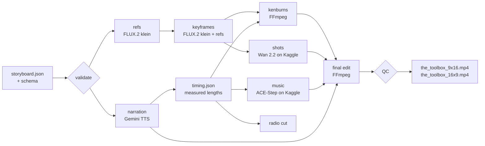

# ARCHITECTURE — how "The Toolbox" is built

A small pipeline of stages. `storyboard.json` is the contract every stage reads. Every model output
is stored under a content-addressed cache key, so changing one shot regenerates only that shot.
Every call, cache hit, retry, fallback and Kaggle job is logged to `runs.jsonl`.

## 1. Stages



| Stage | Command | Reads | Writes | Provider chain (free profile) |
|---|---|---|---|---|
| validate | `make validate` | storyboard.json, schema | — (report) | — |
| script | `make script` | a brief | `storyboard.draft.json` (never the real one) | Gemini 3.8 Flash → 3.5 Flash → 3.5 Flash-Lite |
| narration | `make narration` | narration lines, voices, styles | `outputs/narration/<shot>/<key>.wav`, `timing.json` | Gemini 3.8 Flash TTS → Flash-Lite TTS |
| narration check | `make narration-check` | the takes | `verify.json` (heard-back transcripts) | Gemini 3.5 Flash-Lite → 3.5 Flash |
| radio | `make radio` | takes, timing | `outputs/cuts/radio_cut.mp4` | FFmpeg |
| refs | `make refs` | style + character descriptions | `outputs/refs/<item>/<key>.jpg`, contact sheets | FLUX.2 klein 4B → FLUX.1 schnell |
| keyframes | `make keyframes` | shot prompts + chosen refs | `outputs/keyframes/<shot>/<key>.jpg`, contact sheets with crop boxes | same |
| kenburns | `make kenburns` | chosen keyframe, move, shot length | `outputs/kenburns/<item>/<key>.mp4` | FFmpeg zoompan |
| shots | `make shots-push` / `shots-pull` | chosen keyframe, motion prompt | `outputs/shots/<item>/<key>.mp4` | Wan 2.2 TI2V-5B on Kaggle → (Ken Burns in the edit) |
| music | `make music-push` / `music-pull` | music cue, film length | `outputs/music/<cue>_cN/<key>.flac`, auditions | ACE-Step 1.5 on Kaggle → placeholder pad |
| final | `make assemble` | everything above | `outputs/final/the_toolbox_{9x16,16x9}.mp4`, `film.srt`, `qc.json` | FFmpeg |
| film | `make film` | — | all of the above, in order, cached | — |
| costs | `make costs` | runs.jsonl, prices.yaml | COSTS.md sections 1–3 | — |

Human choices are recorded in the storyboard by `make choose ITEM=… PICK=…` (reference sheets,
keyframes, the score). It edits one value in the text and refuses to write if anything else changed.

## 2. The contract

- **`storyboard.json`** holds everything creative: style block, characters (one fixed description
  each, attached word for word to every prompt), props, voices, music cues, and 10 shots (beat,
  reason, image prompt, seed, motion prompt, Ken Burns move, crop focus, narration lines, transition,
  priority). `schema/storyboard.schema.json` (JSON Schema 2020-12) checks its shape;
  `pipeline/common/storyboard.py` adds semantic checks (unique ids, references resolve, the
  estimated or measured length is 60–90 s, a soft privacy lint for digits that look like phone
  numbers or plates).
- **Manifests**: `outputs/<stage>/manifest.json` maps each item to the artifact that is current for
  it: `{cache_key, path, sha256, provider, model, created_at, status, …}`. Old versions stay on disk
  next to it, so a rejected candidate can still be compared.
- **`outputs/` is committed**, so a clean clone has every artifact and `make film` reassembles the
  film without any key.

## 3. Cache keys and staleness

```
cache_key = sha256(canonical_json({stage, stage_version, provider, model, params, seed,
                                   inputs, upstream_hashes}))
```
- `inputs` holds only the storyboard fields the stage uses (narration uses text, voice and style,
  not the image prompt), so an unrelated edit keeps the key.
- `upstream_hashes` holds the sha256 of the files consumed (a Wan job consumes its keyframe).
- An item is **fresh** when its manifest entry has the same key, status ok, and the file exists.
  Anything else is stale and is regenerated; `--force` regenerates regardless.

Worked example (the Ken Burns clip of s03, from `outputs/kenburns/manifest.json`):
```json
{"stage": "kenburns", "stage_version": 1, "provider": "kenburns", "model": "ffmpeg-zoompan",
 "params": {"move": "pan_right", "amount": 0.06, "fps": 24, "size": 1024}, "seed": null,
 "inputs": {"duration_s": 7.47},
 "upstream_hashes": {"keyframe": "817f18a9…"}}      -> e4d11f94bb157fbf…  -> outputs/kenburns/s03/e4d11f94bb157fbf.mp4
```
Choosing another s03 keyframe changes `upstream_hashes.keyframe`, so only s03's clip is re-rendered.
Editing an s03 narration line changes one TTS key, then the measured length, then s03's Ken Burns
`duration_s`. Nothing else changes.

## 4. Failure handling

- **Retries** (`common/retry.py`): errors are classified first. 429 per-minute, 5xx, timeouts and
  connection errors are retried with exponential backoff and jitter, and Retry-After wins. A 429 for
  a *daily* quota is not retried. Validation and auth errors fail fast.
- **Fallback chains** (`config/providers.yaml`, `common/invoke.py`): when a provider is exhausted,
  the next one in the chain is tried and a `fallback` line says why. A missing key stops the run
  with a message naming the stage, the key and where to get it.
- **Quota guards**:
  - **TTS** (10 requests a day): lines are batched into one request and cut at the pauses. Each cut
    is checked by hearing it back and repaired without a new request (EXPERIMENTS E20, FAILURES F09).
  - **Workers AI** (10,000 neurons a day): the keyframe stage generates in shot-priority order and
    defers whole shots that would pass the allowance.
- **Kaggle**:
  - **Hash guard**: inputs go up as a private dataset, and the kernel carries the sha256 of
    `jobs.json`, so it refuses to run on a stale dataset version.
  - **Incremental results**: results are written as each job finishes, so a dead session keeps its
    finished clips.
  - **Per-job OOM ladder**: on running out of memory, decode with VAE tiling, then move the
    transformer to the CPU, then retry at 576 px and 49 frames.
  - **Bad-output checks**: a NaN or black-frame check, and a time budget.
- **QC gates**: the radio cut and the final edit measure their own loudness (EBU R128) and probe
  duration, fps and resolution. The final run fails if they are out of tolerance (`outputs/final/qc.json`).

## 5. Providers and the paid lane

Each stage asks the registry for a chain from the active profile (`free` by default, `--profile
paid` or `PROFILE=paid`). An adapter matches one small protocol (`providers/base.py`):
- `generate_json` for text;
- `synthesize` / `synthesize_batch` for TTS;
- `generate(prompt, seed, w, h, refs)` for images;
- `submit` / `status` / `collect` for the batch-async video and music jobs.

Provider and model are part of every cache key, so switching a profile regenerates exactly the
stages whose provider changed. The paid adapters are stubs that keep the free adapter as their
fallback.

## 6. Logging

`runs.jsonl` has one JSON line per event, with the same keys every time:
- `ts`, `run_id`, `profile`, `event` (model_call, cache_hit, retry, fallback, stale, external_job)
- `stage`, `shot_id`, `provider`, `model`, `params`, `seed`
- `input_hash` (prompts are logged by hash; the text is in the storyboard), `cache_key`, `output`
- `latency_s`, `gpu_s`, `cost_usd`, `list_price_usd`, `attempt`, `status`, `error`

Secrets never reach it (`env.redact`). Kaggle status polls are not logged, and the Kaggle username
is scrubbed from tracked files. `make costs` turns the log into the COSTS.md tables.

## 7. Two aspect ratios from one master

Every picture is a 1024×1024 master with the subject centred and empty space around it.
- 9:16 crops a 576×1024 column and 16:9 a 1024×576 band. `crop_focus` moves the window per shot,
  and the contact sheets draw both boxes so a bad crop is visible before anything is animated.
- The split-screen call (s10) uses two halves: stacked in 9:16, side by side in 16:9, with a thin
  divider.

Same timeline, same subtitles, two encodes.

## 8. Determinism

- Seeds are in the storyboard and in every cache key.
- FLUX.2 klein on Workers AI does not reproduce an image from its seed (FAILURES F07), and TTS is
  not deterministic either. So the **cache is the reproducibility**: the committed artifacts are
  the film, and a rerun only reproduces what is stale.
- FFmpeg steps are deterministic given the same inputs and version (9.0.1).

## 9. Known limitations

- Wan 2.2 runs on free Kaggle T4s in fp16 (no bf16 on a T4). A shot without a fresh clip falls back
  to Ken Burns in the edit, which is still a complete film.
- Wan clips are ~3.4 s and most shots are longer: the edit holds the last frame with a slow drift.
- The style image leaks its own props into other images, and the model drifts towards lighter skin
  unless the text insists (EXPERIMENTS E21, E22). Both are handled in the prompts, and every
  candidate is checked by eye.
- The ACE-Step kernel installs the repo's own locked environment at run time, so it depends on
  GitHub, PyPI and Hugging Face being reachable from Kaggle.
